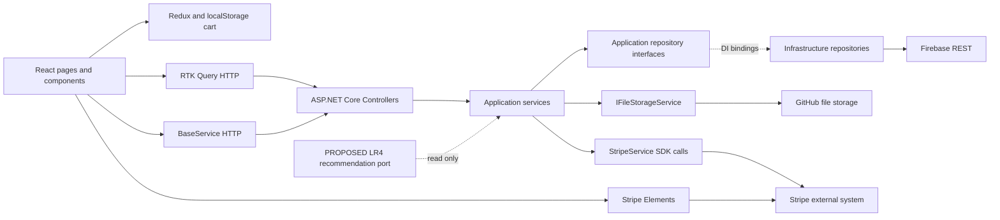
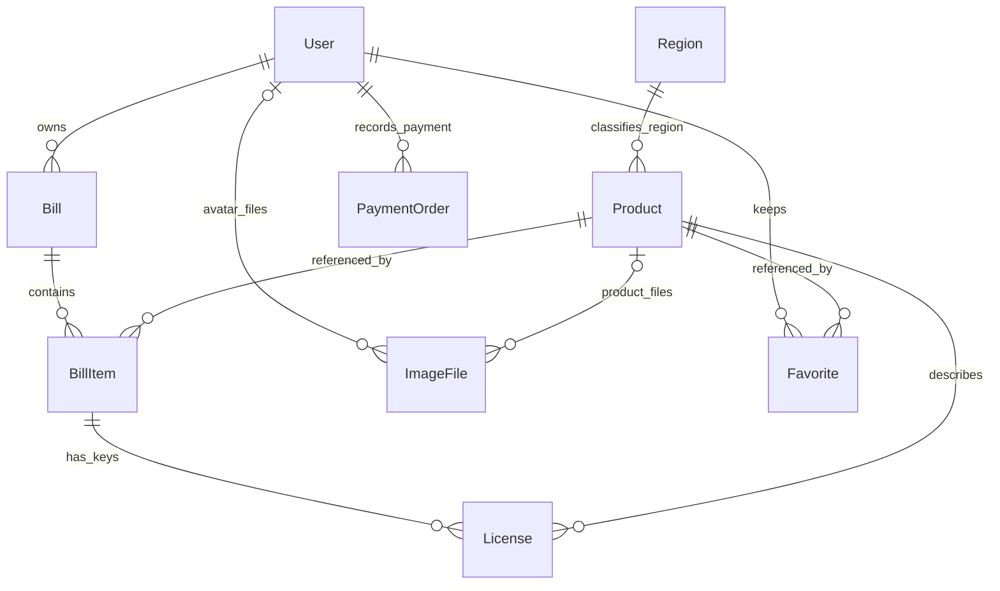
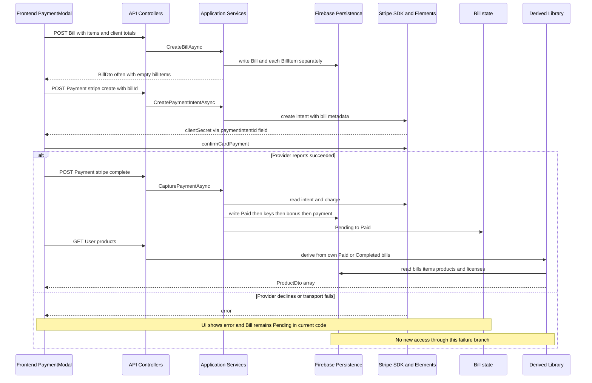
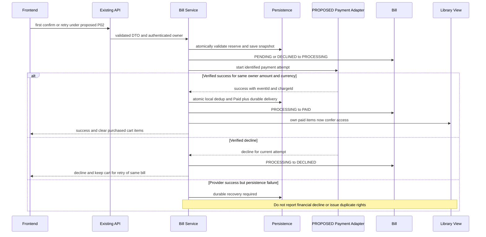

# Архітектура Luden — фактичний стан і проєктні рішення

Версія коду зафіксована в [sources.md](sources.md). Єдині бізнес-правила й поля: [requirements.md](requirements.md); wire-контракт: [api-contract.md](api-contract.md). IMPLEMENTED — статична наявність; працездатність NOT VERIFIED.

## 0. Зв’язок із попереднім UX/UI

Використано Product Baseline/Input Pack/Screen Contracts і версії з sources.md. Початкові AC-02.4 (показ пароля), AC-07.5 (cancel→cart), AC-08.1/08.4 (profile/library/store) відновлено; це UI-компонентні контракти, не нові серверні маршрути. Повний контекст повернення P-07 та guest-resume P-04 — кандидати. Успішний login веде в profile за початковим AC-02.2; P-03 пропонує library, прийняття цієї зміни не підтверджено. P-02 пропонує create Bill на confirm; нині PaymentModal створює Bill при ініціалізації.

Server Cart не є обов’язковим окремим компонентом SRC-03. Наявний Redux/localStorage Cart може лишитися після погодження server-validated checkout; API-P01–P03 — необов’язковий кандидат. Сервер у будь-якому варіанті мусить контролювати власника/суму/права, а після прийняття one-copy політики — конкурентну унікальність. UX-граф не доводить виконання цих інваріантів.

## 1. Стек і напрямки залежностей

Backend: ASP.NET Core Web `net9.0`; Application/Entities/Infrastructure `net8.0`; EF Core 9.0.10, Npgsql/SQLite пакети є, проте active persistence — Firebase Realtime Database REST. JWT Bearer 9.0.10, Stripe.net 49.2.0, Google.Apis.Auth 1.72.0, Swashbuckle 9.0.6. FileStorage — IFileStorageService з GitHubStorageService, метадані ImageFile у Firebase. Вкладені дублікати проєктів — GAP-22, не окремий погоджений архітектурний шар.

Frontend: React 19.1, TypeScript ~5.8.3, Vite ^7.0.4, React Router ^7.9.4, Redux Toolkit ^2.10.1/RTK Query, Stripe Elements, Capacitor ^8 Android. Це діапазони package.json, точні resolved packages зафіксовані package-lock. Мобільна напрацювання є, обсяг ЛР 1 не розширює.

На рівні project references: Entities не посилається на інші проєкти; Application → Entities; Infrastructure → Application + Entities; LudenWebAPI → усі три. Абстракції репозиторіїв лежать в Application, реалізації — в Infrastructure. DI/composition root — Program. Деякі репозиторії створюють FirebaseService вручну, що обходить DI і ускладнює ізоляцію тестів. Entities має зовнішні пакети й StripeOptions, тому це не чиста незалежна domain-бібліотека.

Схема показує логічний runtime потік; DI bindings — реалізація інтерфейсів, а не source-level залежність Application від Infrastructure. Платіжний код в Application прив’язаний до Stripe напряму; незалежний адаптер лише запропонований.

## 2. Компоненти та контракти

| Компонент / код | Відповідальність | Вхід → вихід | Залежності / обмеження |
| --- | --- | --- | --- |
| API Controllers; [LudenWebAPI/Controllers/ProductController.cs:1](https://github.com/Ramseer24/Luden-Back-End/blob/fb5ba5a66f4b3001b608e3e3999c3aa2f0ccaaff/LudenWebAPI/Controllers/ProductController.cs#L1) | HTTP/binding/response; JWT middleware, локальні role-check | DTO/form/id → ActionResult/DTO/text | Application interfaces; owner-check не всюди, 400/500 різнорідні |
| AuthorizationService / BaseTokenService | реєстрація/password/OAuth та випуск JWT | UserRegister/LoginDTO → enum/JWT | IUserRepository, IPasswordHasher; підтвердження/≥8 API відсутні |
| ProductService; [Application/Services/ProductService.cs:1](https://github.com/Ramseer24/Luden-Back-End/blob/fb5ba5a66f4b3001b608e3e3999c3aa2f0ccaaff/Application/Services/ProductService.cs#L1) | CRUD і мапінг ProductDto, cover | Create/UpdateProductDto → ProductDto | IGenericRepository&lt;Product&gt;, IFileService; серверних query/genre немає |
| BillService; [Application/Services/BillService.cs:1](https://github.com/Ramseer24/Luden-Back-End/blob/fb5ba5a66f4b3001b608e3e3999c3aa2f0ccaaff/Application/Services/BillService.cs#L1) | створення Bill/Items, mapping history | довірені нині userId/amount/status/items → Bill/Dto | IBillRepository, IUserService, Product/Item repos; немає транзакції/матриці |
| StripeService; [Application/Services/StripeService.cs:1](https://github.com/Ramseer24/Luden-Back-End/blob/fb5ba5a66f4b3001b608e3e3999c3aa2f0ccaaff/Application/Services/StripeService.cs#L1) | create/confirm/capture, license/bonus ефекти | billId / intentId → ClientSecret / PaymentOrder | Stripe SDK і декілька репозиторіїв; не provider-neutral, немає durable attempt |
| UserService/UserRepository | профіль та похідна бібліотека | JWT userId → UserProfileDTO/ProductDto[] | Bill/Item/Product/File/License; фільтр Paid/Completed є, License scope помилковий |
| Infrastructure/FirebaseDatabase; [Infrastructure/FirebaseDatabase/FirebaseService.cs:1](https://github.com/Ramseer24/Luden-Back-End/blob/fb5ba5a66f4b3001b608e3e3999c3aa2f0ccaaff/Infrastructure/FirebaseDatabase/FirebaseService.cs#L1) | REST-збереження JSON | path/object → FirebaseResult/RawJson | зовнішня Firebase, config з файлу; FK/unique/cascade/transaction не забезпечено |
| Infrastructure/Repositories; [Infrastructure/Repositories/GenericRepository.cs:1](https://github.com/Ramseer24/Luden-Back-End/blob/fb5ba5a66f4b3001b608e3e3999c3aa2f0ccaaff/Infrastructure/Repositories/GenericRepository.cs#L1) | CRUD і ID | IEntity → async writes/reads | помилки можуть приховуватися як успіх/пусто; GET+PUT race |
| FileService + GitHubStorageService | upload/metadata/url | stream/meta → ImageFile/URL | IFileRepository, IFileStorageService; зовнішня інтеграція NOT VERIFIED |
| src/main.tsx → app/router/routes.tsx; [src/app/router/routes.tsx:1](https://github.com/Timbuhtuk/Luden-Front-End/blob/ea90e7f465012d78d2f0593ad745ffb0ea07106c/src/app/router/routes.tsx#L1) | активна точка входу й маршрути UI | URL → Login/Registration/Profile/Store тощо | basename /Luden-Front-End; корінь Login; загального auth guard немає |
| src/shared/api/rtkApi.ts + rtkBaseQuery.ts | кеш і HTTP/binding API | hooks → fetch → normalized data/errors | Bearer із local/sessionStorage, 401 чистить токени; типи payment mutations void не відповідають response |
| src/services/BaseService.ts, BillService/PaymentService | окрема HTTP-гілка чинної оплати | objects/raw JSON → response/throw | використовується PaymentModal, не весь платіж іде RTK; різні правила error/cache invalidation |
| src/entities/Cart/model/cartSlice.ts | локальний склад кошика | Redux actions → localStorage cartItems | не серверний Cart; quantity increments, не user-scoped |
| src/pages/StorePage; widgets/Cart; components/PaymentModal | каталог, локальна фільтрація, оплата | ProductDto → Game UI, Bill create, Stripe confirm → complete | активний Cart імпортується @widgets/Cart; інші Cart копії не вважати активними |
| src/pages/ProfilePage | профіль/історія/бібліотека | profile/user Bills/products hooks → UI | localStorage-only guard; plain read query не доводить correct entitlement |
| android/; capacitor.config.ts | наявна Android оболонка | web build → Capacitor app | F, майбутній обсяг; Android build не запускався |

## 3. Фактичні сутності й логічні зв’язки

Це ER-модель ПОСИЛАНЬ і очікуваних кратностей, не фізична SQL-схема. У Firebase не доведено існування правого/лівого кінця кожного зв’язку; orphan записи можливі. UserId у PaymentOrder.update-status може бути 0, порушуючи очікуваний зв’язок. BillItem→License фактично 0..N через Quantity; після прийняття Q-06 ціль 0..1 на позицію, але це ще не обмеження сховища.

Власник Bill — User; власник BillItem/прав — той самий User через Bill. License не містить UserId, ownership проходить через BillItem→Bill. Product не володіє правом користувача; видалення Product не повинно відбирати оплачений доступ (D-01). PaymentOrder НЕ має BillId у моделі, зв’язок з Bill лише у Stripe metadata, тому на ER не вигадано FK PaymentOrder→Bill. Product.CoverFileId та User.AvatarFileId — окремі nullable посилання на ImageFile; Files містять ProductId/UserId. Cart-сутності в backend немає; target Cart зв’язки наведені в requirements як PROPOSED, не намальовані фізично.

У старих EF migrations є cascade; active Program не використовує DbContext. Firebase FK, каскадне видалення й unique-index не реалізовані. Ідентифікатори `ulong`, ціни `decimal`; ProductDto звужує regionId до int? — GAP-20.

## 4. Потік покупки — як написано

Ця схема відображає перевірений код, а не запуск. Зовнішня Stripe існує як SDK-виклики, не як підтверджена працююча транзакція. Контрольована тестова інтеграція ще не налаштована. Крім показаної UI-гілки існує update-status API з конфліктом GAP-08. Завершення неатомарне, ownership/money вразливості GAP-01–05 можуть обійти очікуваний шлях.

### Цільовий потік після прийняття рішень

У target кожне слово atomically стосується локального контрольованого запису/claim. Stripe не є частиною спільної DB-транзакції. Обрана реалізація Firebase atomic multi-location update або іншого механізму, outbox/reconciliation і час recovery — D-06 OPEN. Через це target не названо реалізованим.

## 5. ADR

### ADR-01: бібліотека як похідне подання

Статус: PROPOSED як архітектурне рішення, код частково IMPLEMENTED. Контекст: SRC-05 і BR-08 вимагають власні Paid/Completed Bill. Варіанти: незалежний список entitlements; похідний DISTINCT із Bill/Items; License як єдине право. Обране робоче рішення — похідний список із Bill/Items, оскільки він має єдине джерело фінансової підстави. License зберігається як ключ доставки та НЕ вилучається з реальної моделі. Наслідок: після видалення Product чи Bill необхідно зберігати доступ/історію; потрібні безпечні joins і фільтр ключів до власних Items. Відповідність: UserRepository.GetUserProductsByIdAsync уже перевіряє власника й Paid/Completed, але GAP-01/04/10 руйнують наскрізну гарантію. Не вважати ADR повністю виконаним.

### ADR-02: платіжний адаптер

Статус: PROPOSED / OPEN; поточна інтеграція Stripe IMPLEMENTED, працездатність NOT VERIFIED. Контекст: методичка лишає провайдера відкритим, код уже має IStripeService/StripeService і Stripe Elements. Варіанти: залишити orchestration/провайдера в одному сервісі; відокремити provider port із Stripe-адаптером; новий провайдер. Робочий вибір — відокремити вузький адаптер і зберегти Stripe як наявний кандидат, не міняти провайдера через AI-пораду. Причина: керовані success/decline/duplicate/failure без зовнішнього списання в тестах, одне місце перевірки метаданих. Наслідок: IStripeService нині містить магазинні побічні ефекти, отже це не готовий provider-neutral port; потрібний окремий погоджений рефакторинг. Вебхуків і fake-adapter у коді не знайдено.

### ADR-03: фіксація ціни

Статус: PROPOSED; поле snapshot IMPLEMENTED частково. Контекст: змінений Product.Price не має переписувати погоджену суму створеної Bill. Варіанти: поточна ціна при кожному читанні; клієнтський snapshot; серверний snapshot. Обране робоче рішення — серверний BillItem.PriceAtPurchase плюс Bill.TotalAmount/Currency. Причина: відтворювана оплата й захист від підміни. Наслідок: precision, discount й rounding мають бути прийняті D-03; після створення snapshot immutable, повтор оплати використовує ту саму суму. У коді PriceAtPurchase є, але бере itemDto.Price, totalAmount теж клієнтський — GAP-14. Не мігрувати на minor-unit int тільки за попереднім AI-проєктом: поточні domain-поля decimal, Stripe boundary конвертує ×100.

## 6. Точка ЛР 4

PROPOSED read-only recommendation port біля Application catalog service: вхід — безпечний catalog summary/жанри й явно дозволені користувацькі параметри; вихід — список candidate ProductId із поясненням для UI. Не віддавати ключі, паролі, платіжні метадані. Відповідь не змінює Cart/Bill/License, рішення купити лишається за користувачем. Endpoint, LLM vendor і промпт не визначені й не реалізуються в ЛР 1. Наявний UI-напис Recommendations не є доказом LLM-інтеграції.

## 7. Межі повноважень і життєвого циклу

JWT middleware автентифікує, але ownership-check лишається обов’язком сервісу/API на кожному Bill/Payment/Library запиті. Code-backed відсутності перевірок у Bill і payment finalize позначені CONFIRMED у implementation-audit.md; можливі наслідки для чужих даних/ключів POTENTIAL до відтворення. Ліцензія не надає права окремо від власної Paid/Completed Bill; видачу даних ключів треба scope-нути до власних BillItem.

Підтвердження командного review не змінює source-код і не закриває ці дефекти. Дату/коміт індивідуальних перевірок не вигадано. Усі майбутні tests NOT RUN; точка рекомендацій ЛР 4 лише read-only port, не діючий LLM.
